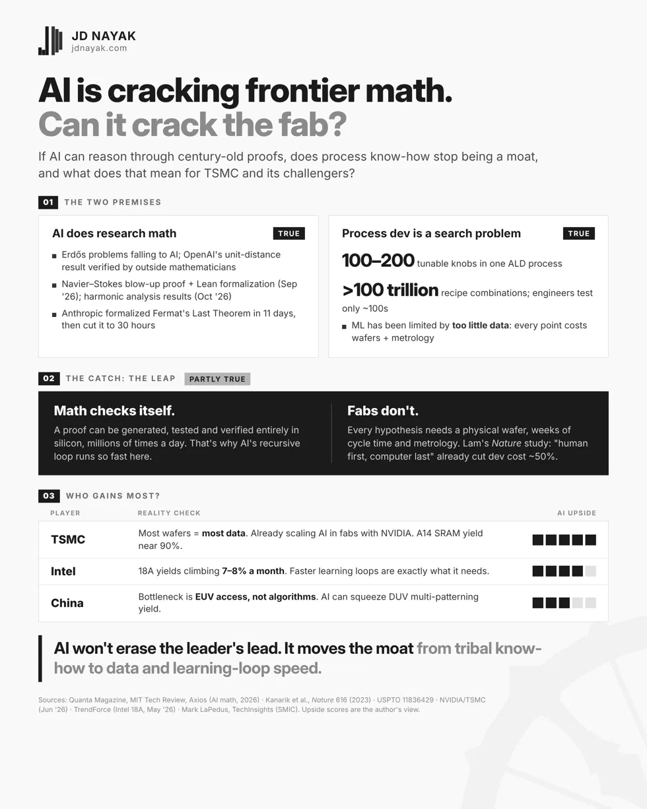

import ThemedImage from '~/components/ui/ThemedImage.astro';

2026 has been the year AI stopped being a math _student_ and became a math _researcher_. In six months it went from an 80-year-old Erdős problem to a claimed proof of the Riemann hypothesis, the most famous open problem in mathematics.

That raised a question I could not shake. Semiconductor process development is, at its core, a giant optimization problem: hundreds of correlated parameters, small experiments stitched together, and slow refinement towards a recipe that works. If AI can now reason through problems that have stumped mathematicians for a century or more, shouldn't it also tear through process development? And if it does, does that erode the one thing that has kept TSMC ahead for a decade: hard-won process know-how?

I started with a hypothesis and then tried to break it. Here is what held up, what didn't, and where I landed. If you only have a minute, this is the short version:

## The hypothesis

Stated plainly, the chain of reasoning goes like this:

1. Frontier AI models from OpenAI, Anthropic and Google are now solving genuinely hard math problems.
2. Semiconductor process improvement is hard mainly because many parameters are correlated, and learning has to be stitched together from many smaller experiments.
3. If AI can solve hard math, and can increasingly improve itself, it should dramatically accelerate process improvement.
4. Therefore TSMC, whose moat is largely process learning, will find it harder to maintain its lead.
5. Therefore challengers like Intel and China stand to benefit the most.

Each link sounds reasonable. Let's test them one at a time.

## Premise 1: AI is doing research-level math — TRUE

This one is not hype anymore, though it comes with caveats.

<ThemedImage
  name="ai-math-2026-timeline"
  alt="Timeline of AI mathematics milestones in 2026, from Erdős problem 90 in May to the claimed Riemann hypothesis proof on November 20"
/>

### The warm-up: Erdős problems

Paul Erdős left behind hundreds of open problems, and over the past year they became the proving ground for AI in mathematics. In late May, an internal OpenAI model produced a result on the planar unit distance problem (Erdős Problem 90), a question open since 1946. Outside mathematicians verified it, and [AIhub described it](https://aihub.org/2026/06/02/an-ai-solution-to-an-80-year-old-problem-has-shocked-mathematicians/) as the first major open problem solved by AI with minimal human help beyond the initial prompt. Within days, mathematician Will Sawin improved on it, and Google DeepMind reported resolving nine lesser Erdős problems with its own models.

There is an honest caveat. A [Google DeepMind case study](https://arxiv.org/html/2601.22401) found that many "open" Erdős problems that AI resolved were open because they were _obscure_, not because they were _hard_. Some answers were already sitting in the literature. And [Scientific American](https://www.scientificamerican.com/article/chatgpt-just-proved-another-50-year-old-math-conjecture/) noted that several AI proofs needed few genuinely new ideas; they combined known methods and pushed them further. That pattern matters for the fab question, as we'll see.

### Navier–Stokes: the equations of fluid flow

The Navier–Stokes equations describe how fluids move: air over a wing, water in a pipe, gas through a showerhead in a plasma chamber. One of the Clay Mathematics Institute's seven [Millennium Prize Problems](https://www.claymath.org/millennium-problems/) asks whether their solutions in three dimensions always stay smooth, or whether they can "blow up" and develop a singularity in finite time.

On September 8, OpenAI [announced](https://www.scientificamerican.com/article/openai-claims-blockbuster-math-breakthrough-amid-swirl-of-controversy/) that an internal model had proved that they can blow up, and said the proof had been certified in the Lean proof assistant. According to [The Next Web](https://thenextweb.com/news/openai-navier-stokes-claim-verification-credit), the run used about 10,000 agents working concurrently for roughly 88 hours, at a cost OpenAI put "in the millions of dollars". The company said it would not claim the $1 million prize. The announcement was [overshadowed by a credit dispute](https://www.technologyreview.com/2026/09/08/1143747/what-openais-latest-controversy-tells-us-about-the-future-of-math): NYU mathematician Tristan Buckmaster, who had been working on closely related problems with Anthropic's Levent Alpöge, alleged that OpenAI had drawn on his unpublished approach. OpenAI denied it.

There was also a mathematical catch. OpenAI's construction relied on an external force, finely tuned to "stir" the fluid into blowing up. That technically fits the Clay problem statement, but many experts wanted the cleaner, unforced case. On November 20, Buckmaster and Alpöge posted an AI-assisted proof of exactly that: [blow-up with no outside force](https://www.scientificamerican.com/article/ai-just-solved-the-real-navier-stokes-problem/). They describe the write-up as unpolished, and it has not yet been independently verified.

### The Riemann hypothesis: the big one

If Navier–Stokes is the hardest problem in applied mathematics, the Riemann hypothesis is the most famous problem in pure mathematics. Bernhard Riemann posed it in 1859. It says that all the non-trivial zeros of the zeta function lie on a single line, and it governs how the prime numbers are distributed. It is also a Millennium Prize Problem, and generations of the best mathematicians have failed to prove it.

The ground shifted in two steps:

- **October: the quasi-Riemann hypothesis.** On October 6, OpenAI released a batch of AI-generated papers that included a proof of a weaker statement, which confines all the zeros to a narrower band, between 1/8 and 7/8. The version that places them in that band was verified in Lean. [Quanta Magazine](https://www.quantamagazine.org/ai-proved-the-quasi-riemann-hypothesis-what-happens-now-20261019/) reported that experts largely agree it is correct. Mathematician Jared Duker Lichtman called it "the most significant AI-for-math achievement so far, by quite a margin". Maksym Radziwiłł called the papers "horribly written" by journal standards, while agreeing the mathematics holds up.
- **November: the full hypothesis.** On November 20, Levent Alpöge, an Anthropic mathematician, [announced](https://www.ibm.com/think/news/anthropic-claude-riemann-hypothesis-math-proof) that he and Claude had produced a proof of the Riemann hypothesis itself, released as a Lean library of [more than 17 million lines of code](https://phys.org/news/2026-11-sacred-mathematics-riemann-hypothesis-ai.html). The Lean Focused Research Organization and the Mathlib community issued a joint statement saying they believe the proof is correct. Fields medallist James Maynard said that "if this fully checks out, it is clearly a historic milestone in mathematics", while noting that checking it will take time.

The most striking reaction came from mathematician Daniel Litt: the formalized proof is "exceedingly likely to be correct", and yet "no human understands it yet."

Hold on to that sentence. It is the key to the whole fab question.

### Formal verification at scale

The other trend I find most important is speed. According to [Quanta](https://www.quantamagazine.org/update/169054/), Anthropic formalized the proof of Fermat's Last Theorem in September, a job that took a swarm of agents 11 days and produced some 13 million lines of code. On November 9, Anthropic researchers announced that the same job could now be done in about 30 hours. OpenAI, meanwhile, announced a proof of the local smoothing conjecture in harmonic analysis on October 26, [posted together with a Lean verification](https://www.quantamagazine.org/update/168664/).

**Verdict:** Premise 1 holds. AI is now a real contributor to research mathematics. The biggest claims, Riemann and unforced Navier–Stokes, are days old and still being checked, and some headlines oversell individual results. But the direction is no longer in doubt.

## Premise 2: process development is a high-dimensional search problem — TRUE

Anyone who has worked near a fab knows this intuitively. The numbers make it concrete:

- **A single process step has a huge number of knobs.** A typical atomic layer deposition (ALD) process has [100–200 tunable parameters](https://image-ppubs.uspto.gov/dirsearch-public/print/downloadPdf/11836429): gas flows, plasma conditions, temperatures, timings. Getting to a near-perfect recipe typically takes a team of engineers weeks or months.
- **The search space is effectively infinite.** Lam Research estimates there are [more than 100 trillion possible combinations](https://meetings-archive.aps.org/gec/2024/em2/5) for a plasma etch recipe. At SEMICON West 2026, Lam's David Fried put the number of possible process recipes [on the order of 10²³](https://semiwiki.com/events/375312-semicon-west-2026-ai-made-the-steps-faster-the-time-between-them-is-next/). Engineers typically test on the order of a hundred.
- **Classical DOE helps, but it is expensive.** Screening designs, response surfaces and Taguchi arrays all work. They also all need many physical experiments to work out how factors interact.
- **And this is just one step.** A leading-edge flow has well over a thousand process steps. Yield emerges from how they interact, and the learning is stitched together across many smaller experiments, splits and lots.

There is one detail that is easy to skip past but matters more than any other: according to Lam's researchers, machine learning in process development has been held back by **too little data**, because every data point is expensive to get.

**Verdict:** Premise 2 holds. Process development is exactly the kind of correlated, high-dimensional search problem that AI should be good at.

## The leap: does AI then "significantly boost" process improvement? — PARTLY TRUE

This is where the hypothesis bends.

### Math checks itself. Fabs don't.

The reason AI is moving so quickly in mathematics is not only that models got smarter. It is that **mathematics has a cheap, perfect checker**. A proof assistant like Lean can tell you, in software, whether a proof is correct. That means an AI system can generate a candidate, check it, learn from the failure and try again, thousands or millions of times, at the speed of compute. The Fermat formalization going from 11 days to 30 hours in two months is exactly what a tight, fast loop looks like.

The Riemann claim shows how far that goes. The proof is 17 million lines long and, in Litt's words, no human understands it yet. The community can still be confident in it, because the checker doesn't need to understand it. It only needs to verify every step.

A fab has no such checker. Every process hypothesis has to be tested on a physical wafer. That wafer goes through deposition, lithography, etch and metrology. Results arrive after hours for a single module experiment and weeks for a full flow. Every iteration consumes tool time, wafers, chemicals and engineering hours.

<ThemedImage
  name="math-loop-vs-fab-loop"
  alt="Two learning loops side by side: the math loop of generate, Lean check and learn runs in seconds and is bound by compute; the fab loop of hypothesis, run wafers, metrology and learn takes hours to weeks and is bound by physics"
/>

In math, AI's speed is limited by compute. In a fab, it is limited by physics. Better reasoning does not change the speed of light in a plasma chamber or the cycle time of a 1,000-step flow.

### What the best evidence actually shows

The most rigorous study I know of is Lam Research's [2023 paper in _Nature_](https://www.nature.com/articles/s41586-023-05773-7), "Human–machine collaboration for improving semiconductor process development". Lam built a virtual process "game" for a high aspect ratio etch and pitted senior engineers, junior engineers and Bayesian optimization algorithms against each other to hit a target at the lowest cost.

The findings are revealing:

- Experienced engineers were best in the early, messy phase of development, where intuition and physical understanding narrow the space quickly. According to [IEEE Spectrum](https://spectrum.ieee.org/chip-design), the best single player was a senior engineer, and only 13 of 300 computer attempts, fewer than 5%, beat that person.
- Algorithms were better in the later phase: fine-tuning once the region of interest was known.
- The winning strategy was **"human first, computer last"**. The best human reached the target for $105,000; the hybrid got there for $52,000, roughly [half the cost](https://www.eenewseurope.com/en/lam-research-pits-process-engineers-against-ai/).

A 50% reduction in development cost is a big deal. But note what it is: a large efficiency gain inside the same loop, not a different kind of loop. That study used 2023-era optimization algorithms. Today's reasoning models would almost certainly do better, especially in the early phase where engineers currently win. Even so, the physical experiment remains the bottleneck.

### Where the "math" analogy _does_ come true

The analogy is not wrong. It's early. AI starts to behave in the fab the way it does in math in exactly the places where we can **move the experiment into software**:

- **Better simulators.** If plasma, deposition and transport models become accurate enough, they become the "proof checker" for process development. The tools are getting faster: Applied Materials reported cutting a gate-all-around device simulation [from 20.5 days to 19.7 hours](https://semiwiki.com/events/375312-semicon-west-2026-ai-made-the-steps-faster-the-time-between-them-is-next/) on GPUs. And it is worth noticing that the Navier–Stokes work is about fluid dynamics. A blow-up proof will not tune your etch recipe, but models that can reason about the mathematics of physical systems could eventually help build better process simulators.
- **Virtual metrology and digital twins.** Predicting outcomes from tool sensor data, instead of waiting for physical measurement, shortens the loop. Lam says its integrated lab network and virtual twins have [shortened process development by up to 2.5 times](https://electronics360.globalspec.com/article/24098/lam-research-to-invest-3-billion-on-r-d-lab-network), a company claim but a telling one.
- **Surrogate models and Bayesian optimization.** These cut the number of wafers needed for each learning cycle.
- **Codifying tacit knowledge.** Much of what senior engineers know lives in their heads, old reports, SPC charts and excursion notes. Large models are well suited to turning that into something searchable and reusable.

The more of the learning loop moves into software, the more AI's advantage compounds. That is the real prize, and it is still being built.

**Verdict:** AI will significantly improve process development, but through faster learning loops, not a sudden math-style leap. The gains will be large and steady, not overnight.

## Does TSMC lose its lead? — PROBABLY NOT

This is where I changed my mind the most.

If AI's gains in the fab depend on data and learning loops, then the company with the **most data and the fastest loop** benefits the most. That company is TSMC.

- **Data scale.** TSMC runs more leading-edge wafers than anyone else. Every wafer is a data point. AI amplifies data advantages; it doesn't erase them.
- **It is already all in.** TSMC [describes AI systems](https://www.tsmc.com/english/dedicatedFoundry/manufacturing/engineering) for fault detection and classification, intelligent equipment control and process control across its fabs. In June 2026, NVIDIA announced that [TSMC is applying NVIDIA accelerated computing and AI](https://www.hpcwire.com/off-the-wire/nvidia-and-tsmc-bring-ai-into-fabs-to-advance-semiconductor-design-and-manufacturing/) across design and manufacturing to improve cycle time, yield and productivity.
- **Execution keeps compounding.** At its July 2026 earnings call, TSMC reported that its next-generation A14 process had a 256 Mb SRAM test structure yielding [close to 90%](https://www.igorslab.de/zh/tsmc-a14-90-percent-sram-yield-risk-production-2027-zh-cn/) ahead of production in 2028.

There is one real way this could hurt TSMC: if AI makes process know-how **portable**. Today, a lot of TSMC's advantage is tacit and embedded in its people and culture. If AI systems, equipment vendors' embedded models or simulation tools start packaging that learning in a form others can buy, the gap narrows. Equipment makers like Lam and Applied Materials are already moving in this direction with digital twins and AI-driven tools. That is the scenario to watch, but it isn't today's reality.

**Verdict:** AI is more likely to widen TSMC's lead in the near term than to erode it. The moat doesn't disappear. It moves, from tribal know-how to data and learning-loop speed.

<ThemedImage
  name="fab-moat-shift"
  alt="The fab moat shifts from tribal know-how (senior engineers' intuition, recipe histories, decades of yield learning) to data and loop speed (wafer volume, connected MES, SPC, FDC and metrology data, hypothesis-to-answer time)"
/>

## What about the challengers?

AI helps everyone. It doesn't help everyone equally.

### Intel: the biggest winner among challengers

Intel's problem has never been a lack of physics talent. It has been yield learning speed and customer confidence. That is exactly where AI helps most.

The trajectory is encouraging. In May 2026, Intel CEO Lip-Bu Tan said 18A yields were [improving by 7–8% per month](https://www.trendforce.com/news/2026/05/19/news-intel-18a-yields-improve-7-8-monthly-with-2h26-customers-expected-reportedly-pushes-18a-cpus-amid-tight-supply/), and that Intel expected commitments from multiple foundry customers in the second half of 2026. By the summer, one research firm reported that Intel had [fixed its wafer-to-wafer yield variation](https://www.tomshardware.com/tech-industry/semiconductors/intel-18a-wafer-to-wafer-yield-issues-fixed-report-claims-says-production-up-to-15-000-wafers-per-month-at-both-sites) and was ramping to 12,000–15,000 wafers a month at two sites, and in September an analyst [estimated Panther Lake compute-tile yield at around 80%](https://www.techpowerup.com/352724/). Neither figure is confirmed by Intel, but the direction is clear. A company climbing a yield curve is exactly the company that benefits from a faster learning loop. If AI compresses each turn of that loop, Intel could close gaps faster than its history suggests.

### China: AI can't replace a missing tool

China's position is different. SMIC's challenge at the leading edge is not mainly about optimization. It is about equipment. Without EUV, SMIC relies on DUV multi-patterning, which adds process steps, cost and many more ways to lose yield.

The evidence suggests SMIC can build advanced chips but struggles to build them cheaply at scale. [TechInsights analysis](https://techinsights.com/zh-cn/node/60833) confirmed the Kirin 9030 uses SMIC's N+3 process, a scaled evolution of its 7nm-class technology, pushing towards 5nm without EUV. Chinese-language media have reported 5nm-class yields of only [30–40%](https://hao.cnyes.com/post/246742); those numbers are unverified, but they fit the broader picture. Meanwhile, [Nikkei reports](https://www.trendforce.com/news/2026/02/25/news-china-reportedly-aims-to-boost-7nm-5nm-output-fivefold) that China wants to increase advanced-node output fivefold within one to two years.

This is where AI genuinely helps China: multi-patterning is a correlated, many-step optimization problem, and squeezing yield out of a constrained toolset is exactly what better learning loops do. China also has no shortage of AI talent or compute for this kind of work. But AI can't conjure an EUV scanner. It raises China's yields on the nodes it can build; it doesn't let China skip nodes.

### The scorecard

| Player    | Reality check                                                                    | AI upside |
| --------- | -------------------------------------------------------------------------------- | --------- |
| **TSMC**  | Most data, fastest loop, already scaling AI in its fabs                          | ■■■■■     |
| **Intel** | Climbing the 18A yield curve; faster loops are exactly what it needs             | ■■■■□     |
| **China** | Bottleneck is EUV access, not algorithms; AI improves DUV multi-patterning yield | ■■■□□     |

_Upside scores are my own view, not a forecast._

## My verdict

My original hypothesis was half right.

**Right:** AI is solving hard math, process development is the kind of problem AI should be good at, and AI will meaningfully accelerate process improvement.

**Wrong:** the assumption that this would weaken the leader. In math, AI's loop is limited by compute, and a checker like Lean lets the community trust a 17-million-line proof that no one has read. In the fab, the loop is limited by wafers, tools and cycle time, and the only checker is the wafer itself. Whoever has the most data and the fastest physical loop captures most of the gain. Today, that is TSMC.

So the competitive question for the next decade changes. It's no longer just _who has the best process engineers?_ It is:

> **Who builds the fastest learning loop between the model, the tool and the wafer?**

## What this means for people running fabs

If you work in manufacturing, the practical implications are less glamorous than the headlines, but more useful:

1. **Your data infrastructure is your AI strategy.** MES, SPC, FDC, metrology and equipment data have to be connected, clean and traceable to the lot and wafer level. Models can't learn from data they can't reach.
2. **Measure learning-loop speed.** Track how long it takes from a hypothesis to a statistically meaningful answer. Then attack that number with virtual metrology, smarter experiment design and fewer handoffs.
3. **Capture tacit knowledge now.** Excursion reports, recipe histories and senior engineers' judgment are the training material for the next generation of tools. Most of it is still trapped in documents and people's heads.
4. **Invest in simulation.** Every experiment you can move from the wafer to software makes your loop look a little more like the math loop. Simulation is the closest thing a fab has to Lean.
5. **Keep humans first.** Lam's data is clear: engineers still win the early, ambiguous phase. The best results come from pairing their judgment with machine-driven refinement.

## Signals I'm watching

A few things would change my view:

- **AI-designed process recipes reaching production** with documented reductions in development cycles, not just lab demos.
- **Simulators becoming trustworthy enough** to replace a meaningful share of physical experiments.
- **Equipment vendors packaging process learning** into AI-driven tools that make know-how portable across fabs.
- **Intel's 18A and 14A customer ramps**, and whether its yield learning keeps compounding.
- **Real, verified yield data** from SMIC's advanced nodes.
- **How the Riemann and Navier–Stokes claims hold up** under human review. If a 17-million-line proof is accepted on the strength of a machine checker, that is a template for trusting AI work in other fields, including ours.

AI cracking mathematics is a genuine milestone. But the fab is not a proof. It is a physical system, and physical systems reward whoever learns from reality fastest. AI makes that learning faster for everyone. The question is who turns it into the tightest loop.

_What do you think? Where does AI hit the wall in your fab? Let me know on LinkedIn._

---

### Sources

**AI and mathematics**

- AIhub, "[An AI solution to an 80-year-old problem has shocked mathematicians](https://aihub.org/2026/06/02/an-ai-solution-to-an-80-year-old-problem-has-shocked-mathematicians/)" (June 2026)
- Feng, Luong et al., "[Semi-Autonomous Mathematics Discovery with Gemini: A Case Study on the Erdős Problems](https://arxiv.org/html/2601.22401)" (arXiv, 2026)
- Scientific American, "[ChatGPT just proved another 50-year-old math conjecture](https://www.scientificamerican.com/article/chatgpt-just-proved-another-50-year-old-math-conjecture/)" (2026)
- Clay Mathematics Institute, "[Millennium Prize Problems](https://www.claymath.org/millennium-problems/)"
- Scientific American, "[OpenAI claims blockbuster math breakthrough amid swirl of controversy](https://www.scientificamerican.com/article/openai-claims-blockbuster-math-breakthrough-amid-swirl-of-controversy/)" (September 2026)
- The Next Web, "[OpenAI's Navier–Stokes claim: verification and credit](https://thenextweb.com/news/openai-navier-stokes-claim-verification-credit)" (September 2026)
- MIT Technology Review, "[What OpenAI's latest controversy tells us about the future of math](https://www.technologyreview.com/2026/09/08/1143747/what-openais-latest-controversy-tells-us-about-the-future-of-math)" (September 2026)
- Scientific American, "[AI just solved the 'real' Navier–Stokes problem](https://www.scientificamerican.com/article/ai-just-solved-the-real-navier-stokes-problem/)" (November 2026)
- Quanta Magazine, "[AI proved the quasi-Riemann hypothesis. What happens now?](https://www.quantamagazine.org/ai-proved-the-quasi-riemann-hypothesis-what-happens-now-20261019/)" (October 2026)
- IBM Think, "[Anthropic mathematician claims AI helped solve a 167-year-old math mystery](https://www.ibm.com/think/news/anthropic-claude-riemann-hypothesis-math-proof)" (November 2026)
- Phys.org / The Conversation, "['The sacred object in mathematics': The Riemann hypothesis, AI and a proof no human can read](https://phys.org/news/2026-11-sacred-mathematics-riemann-hypothesis-ai.html)" (November 2026)
- Quanta Magazine updates on [Fermat formalization](https://www.quantamagazine.org/update/169054/) and [local smoothing](https://www.quantamagazine.org/update/168664/) (November 2026)

**Semiconductor process development**

- Kanarik et al., "[Human–machine collaboration for improving semiconductor process development](https://www.nature.com/articles/s41586-023-05773-7)", _Nature_ 616, 707–711 (2023)
- IEEE Spectrum, "[Human-AI team-ups could slash chip-development costs](https://spectrum.ieee.org/chip-design)" (March 2023); eeNews Europe, "[Lam Research pits process engineers against AI](https://www.eenewseurope.com/en/lam-research-pits-process-engineers-against-ai/)"
- APS GEC 2024, "[Human-Machine Collaboration in Semiconductor Process Development](https://meetings-archive.aps.org/gec/2024/em2/5)"
- US Patent 11836429, "[Determination of recipes for manufacturing semiconductor devices](https://image-ppubs.uspto.gov/dirsearch-public/print/downloadPdf/11836429)"
- SemiWiki, "[SEMICON West 2026: AI made the steps faster; the time between them is next](https://semiwiki.com/events/375312-semicon-west-2026-ai-made-the-steps-faster-the-time-between-them-is-next/)" (2026)
- Electronics360, "[Lam Research to invest $3 billion on R&D lab network](https://electronics360.globalspec.com/article/24098/lam-research-to-invest-3-billion-on-r-d-lab-network)"

**Foundries**

- TSMC, "[Engineering Performance Optimization](https://www.tsmc.com/english/dedicatedFoundry/manufacturing/engineering)"
- HPCwire, "[NVIDIA and TSMC Bring AI into Fabs](https://www.hpcwire.com/off-the-wire/nvidia-and-tsmc-bring-ai-into-fabs-to-advance-semiconductor-design-and-manufacturing/)" (June 2026)
- Igor's Lab, "[TSMC A14 SRAM yield](https://www.igorslab.de/zh/tsmc-a14-90-percent-sram-yield-risk-production-2027-zh-cn/)" (July 2026)
- TrendForce, "[Intel 18A yields improve 7–8% monthly](https://www.trendforce.com/news/2026/05/19/news-intel-18a-yields-improve-7-8-monthly-with-2h26-customers-expected-reportedly-pushes-18a-cpus-amid-tight-supply/)" (May 2026)
- Tom's Hardware, "[Intel 18A wafer-to-wafer yield issues fixed, report claims](https://www.tomshardware.com/tech-industry/semiconductors/intel-18a-wafer-to-wafer-yield-issues-fixed-report-claims-says-production-up-to-15-000-wafers-per-month-at-both-sites)" (2026)
- TechPowerUp, "[Intel Panther Lake 18A yield estimate](https://www.techpowerup.com/352724/)" (September 2026)
- TechInsights, "[SMIC N+3 Confirmed: Kirin 9030 Analysis](https://techinsights.com/zh-cn/node/60833)" (December 2025)
- TrendForce, "[China reportedly aims to boost 7nm, 5nm output fivefold](https://www.trendforce.com/news/2026/02/25/news-china-reportedly-aims-to-boost-7nm-5nm-output-fivefold)" (February 2026)
- cnyes, "[SMIC 5nm yield report](https://hao.cnyes.com/post/246742)" (May 2026, Chinese-language; unverified)

---

_**AI disclosure:** This post has been enhanced and modified using AI, including research, editing and the illustrations. The analysis, opinions and upside scores are my own._
